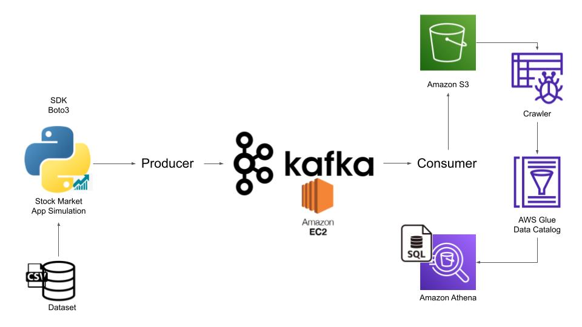

# Real-Time Stock Market Data Engineering Pipeline

### Streaming stock market data with Apache Kafka and AWS

<p align="center">
  
</p>

---

## Overview

An end-to-end data engineering project that simulates real-time stock market data ingestion using Apache Kafka and Python, stores streaming events in Amazon S3, automatically discovers schemas using AWS Glue, and enables analytical SQL queries through Amazon Athena.

The project demonstrates how distributed event streaming technologies can integrate with AWS cloud services to build a scalable data ingestion and analytics pipeline.

## Architecture

The pipeline follows an event-driven architecture:

```text
Historical Stock Market CSV
          |
          v
   Python Producer
          |
          v
    Apache Kafka
     (Stock Topic)
          |
          v
   Python Consumer
          |
          v
      Amazon S3
   (JSON Data Lake)
          |
          v
     AWS Glue Crawler
          |
          v
   Glue Data Catalog
          |
          v
     Amazon Athena
          |
          v
     SQL Analytics
```

## Project Objectives

- Build a streaming data pipeline using Apache Kafka.
- Simulate real-time stock market event ingestion with Python.
- Implement Kafka producers and consumers for asynchronous data processing.
- Persist streaming events in Amazon S3 as JSON files.
- Automate schema discovery and metadata cataloguing with AWS Glue.
- Query cloud-based stock market data using Amazon Athena.
- Understand the integration of distributed messaging systems with AWS data lake services.

## Technology Stack

| Technology | Purpose |
|---|---|
| Python | Data ingestion and processing |
| Apache Kafka | Distributed event streaming |
| Amazon EC2 | Cloud infrastructure for Kafka |
| Amazon S3 | Cloud object storage and data lake |
| AWS Glue Crawler | Automated schema discovery |
| AWS Glue Data Catalog | Centralised metadata management |
| Amazon Athena | Serverless SQL analytics |
| Pandas | CSV data handling |
| kafka-python | Kafka producer and consumer integration |
| s3fs | Python integration with Amazon S3 |

---

## Pipeline Workflow

### 1. Stock Market Data Source

Historical stock market data is used as the source for the pipeline.

Python and Pandas read the CSV dataset, select stock records, and prepare them for streaming.

The producer simulates real-time ingestion by publishing individual stock records at intervals.

### 2. Apache Kafka – Data Streaming

Apache Kafka acts as the distributed messaging layer between data ingestion and downstream processing.

A Kafka topic is created to hold stock market events.

The Python producer serialises individual records into JSON messages and publishes them to the topic.

**Key Kafka components:**

- **Producer:** Publishes stock market events.
- **Topic:** Logical channel that stores related events.
- **Broker:** Kafka server responsible for storing and serving messages.
- **Consumer:** Reads messages from Kafka topics.
- **Partition:** Divides a topic into ordered logs for scalability and parallel processing.

### 3. Python Consumer – Data Ingestion

A Python consumer subscribes to the stock market Kafka topic and continuously reads incoming events.

Each message is processed and prepared for storage.

The consumer uses `s3fs` to connect to Amazon S3 and persist incoming records as JSON files.

### 4. Amazon S3 – Cloud Data Lake

Amazon S3 acts as the persistent storage layer for the streaming data.

Incoming stock market events are stored as JSON objects, making the data available for downstream AWS analytics services.

S3 provides durable, scalable object storage without requiring a traditional database server.

### 5. AWS Glue – Schema Discovery

An AWS Glue Crawler scans the S3 data location to identify the structure and schema of the stored JSON files.

The crawler creates or updates table metadata in the AWS Glue Data Catalog.

This allows downstream analytics services to understand the structure of the data without manually defining every column.

### 6. Amazon Athena – SQL Analytics

Amazon Athena queries the stock market data directly from Amazon S3 using standard SQL.

The Glue Data Catalog provides the table metadata required by Athena.

This enables analytical queries without loading the data into a separate database or data warehouse.

**Example SQL queries**

Retrieve stock market records:

```sql
SELECT *
FROM stock_market_data
LIMIT 10;
```

Count records by stock symbol:

```sql
SELECT
    symbol,
    COUNT(*) AS total_records
FROM stock_market_data
GROUP BY symbol
ORDER BY total_records DESC;
```

---

## Key Data Engineering Concepts Demonstrated

| Concept | Implementation |
|---|---|
| Event streaming | Apache Kafka |
| Data ingestion | Python producer |
| Message consumption | Python consumer |
| Distributed messaging | Kafka topics and brokers |
| Cloud storage | Amazon S3 |
| Data lake architecture | S3 with JSON objects |
| Schema discovery | AWS Glue Crawler |
| Metadata management | Glue Data Catalog |
| Serverless analytics | Amazon Athena |
| SQL-based analysis | Athena queries |

---

## Repository Structure

```text
real-time-stock-market-data-pipeline/
│
├── docs/
│   └── architecture.png
│
├── producer/
│   └── producer.py
│
├── consumer/
│   └── consumer.py
│
├── data/
│   └── README.md
│
├── requirements.txt
├── .gitignore
└── README.md
```

---

## Project Scope and Limitations

This implementation uses historical stock market CSV data to simulate a real-time streaming environment.

The pipeline demonstrates event streaming and cloud-based data ingestion, but it does not connect to a live stock exchange feed or a real-time financial market API.

The architecture can be extended to support live market feeds, more advanced stream processing, partitioned storage, and automated orchestration.

## Potential Enhancements

- Integrate a live stock market API for continuous data ingestion.
- Introduce Apache Spark Structured Streaming for distributed stream processing.
- Implement Kafka consumer groups for parallel consumption.
- Add data validation and duplicate-event handling.
- Partition S3 data by date and stock symbol.
- Store analytical datasets in Apache Parquet format.
- Introduce Apache Airflow for workflow orchestration.
- Build dashboards using Amazon QuickSight or Power BI.

---

## What I Learned

This project provided practical experience integrating Apache Kafka with AWS services to build a cloud-based streaming data pipeline.

It demonstrates how data can move from an ingestion layer through a distributed messaging system into a cloud data lake, where schema discovery and SQL analytics make it accessible for downstream consumption.

**Core Takeaway:**

Apache Kafka handles event streaming, Amazon S3 provides persistent storage, AWS Glue manages metadata, and Amazon Athena enables serverless analytics.

---

## Technologies

`Python` `Apache Kafka` `Amazon EC2` `Amazon S3` `AWS Glue` `AWS Athena` `Pandas` `JSON` `SQL`
